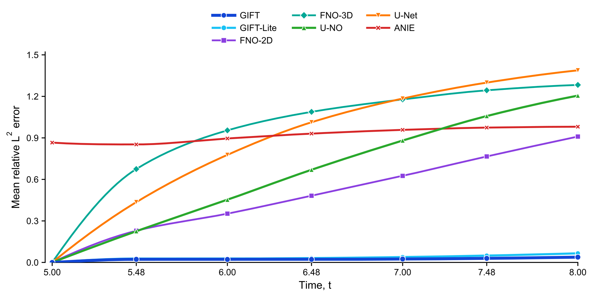
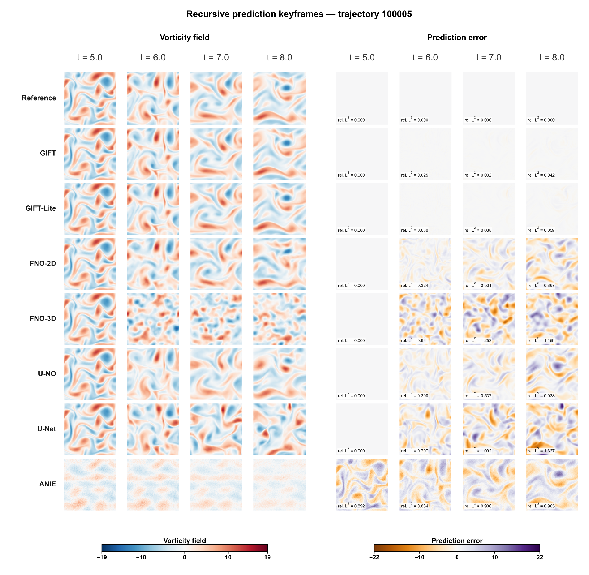
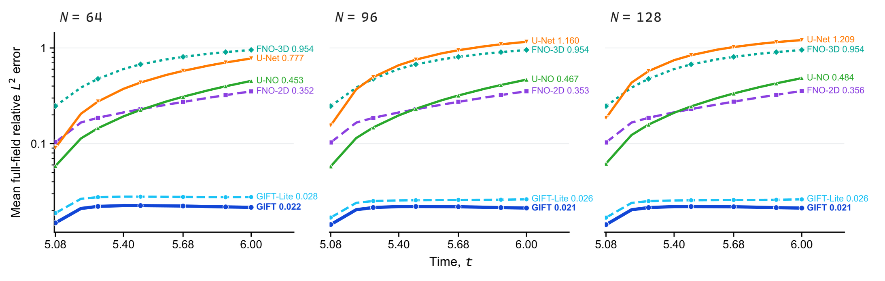
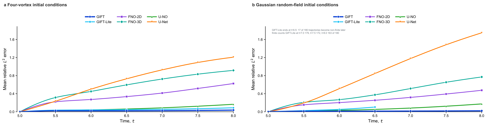
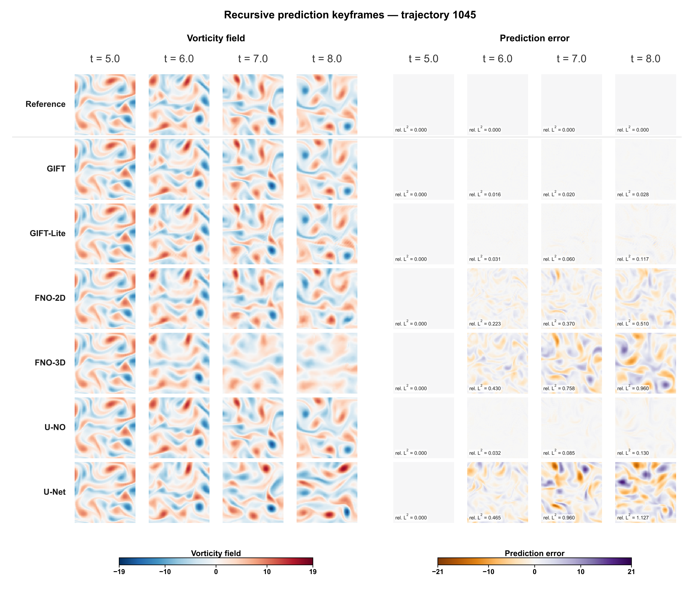

# GIFT numerical experiment record

This record reports methods, data and measured results for flow-evolution prediction, cross-resolution prediction, equation-parameter identification and three auxiliary experiments in manuscript order.

W1 compares GIFT, FNO-2D, FNO-3D, U-NO, U-Net, ANIE and GIFT-Lite, which reduces both training samples and update budget. W2 compares the six methods other than ANIE. Main W1/W2 methods use 300 training trajectories, 20 validation trajectories, one true initial state and a 76-point observation grid from $t=5$ to $8$ at 0.04-second intervals. Hyperparameters are fixed in advance, with one training run per method.

W1/W2 use mean framewise relative $L^2$ across the future 75/25 nodes as their primary metrics and also report endpoint error, MSE and failure counts. Each evaluation population contains 180 trajectories, disjoint from training and validation. Results for both evaluation populations have already been inspected, so they are not blind evaluations; the other test population supports exploratory evaluation. W3 uses a single-trajectory parameter-identification protocol, while S1–S3 use an independent N1000 auxiliary protocol. Training sizes and statistical scopes are specified for each experiment.

## 1. Experiment overview

Experiment identifiers, names and ordering follow W1, W2, W3, S1, S2 and S3 in the manuscript. Code modules, execution entry points and numerical manifests consistently use these identifiers; see [experiment nomenclature](docs/EXPERIMENT_NOMENCLATURE.md).

| ID | Category | Experiment | Purpose | Compared methods | Entry point | Result directory |
| --- | --- | --- | --- | --- | --- | --- |
| W1 | Main experiment | Flow-evolution prediction | N64, t5–8, future75 and failures | GIFT, GIFT-Lite, FNO-2D, FNO-3D, U-NO, U-Net, ANIE | `experiments/additional/w1_current_evaluate.py` | `results/formal/W1_flow_prediction_20261007/` |
| W2 | Main experiment | Native cross-resolution prediction | Train on N64, apply directly to N64/N96/N128, t5–6, future25 | GIFT, GIFT-Lite, FNO-2D, FNO-3D, U-NO, U-Net; no ANIE | `experiments/additional/w2_single_evaluate.py` | `results/formal/W2_cross_resolution_20261007/` |
| W3 | Main experiment | Equation-parameter identification | 50 noiseless parameter cases, one ID0 trajectory per case, independent identification by each method | GIFT, PINN-SR, PDE-FIND, PINN-SR-KC, PDE-FIND-KC | `scripts/run_w3_parameter_job.py`, run independently for each parameter case | [W3 results for 50 noiseless cases](results/formal/W3_single_trajectory_20261010/) |
| S1 | Auxiliary experiment | High-frequency branch effectiveness | Evaluate the branch's overall effect on instantaneous equation right-hand sides and recursive states | GIFT, GIFT-Lite and their respective branch-disabled configurations | `experiments/formal/s1_high_frequency_branch/run.py` | `results/formal/S1_high_frequency_branch/` |
| S2 | Auxiliary experiment | Recursive local correction effectiveness | Evaluate suppression of non-finite outcomes and local error amplification | GIFT, GIFT-Lite and their respective correction-disabled configurations | `experiments/formal/s2_recursive_local_correction/run.py` | `results/formal/S2_recursive_local_correction/` |
| S3 | Auxiliary experiment | Initial-condition distribution comparison | Within-distribution comparison with separate training/testing on four-vortex and Gaussian initial conditions | GIFT, GIFT-Lite, FNO-2D, FNO-3D, U-NO, U-Net | `experiments/formal/s3_initial_distribution/run.py` | `results/formal/S3_initial_distribution/` |

## 2. System, data and common settings

### 2.1 Frequency decomposition

Let $\widehat{\omega}(k_x,k_y)$ denote the two-dimensional Fourier coefficients of state $\omega$. Define the square projection $P_m$ by

$$
\widehat{P_m \omega}(k_x,k_y)=
\begin{cases}
\widehat{\omega}(k_x,k_y), & |k_x|\le m\ \text{and}\ |k_y|\le m,\\
0, & \text{otherwise}.
\end{cases}
$$

$Q_{21}$ is the complementary projection to $P_{21}$, so

$$
Q_{21}\omega=\omega-P_{21}\omega,\qquad
\omega_K=P_{21}\omega,\qquad
\omega_Q=Q_{21}\omega,\qquad
\omega=\omega_K+\omega_Q.
$$

$\omega_K$ is the band-limited state and $\omega_Q$ the complementary state; $Q_{21}$ contains all representable modes outside $P_{21}$. This record does not divide $Q_{21}$ into narrower bands to evaluate the high-frequency branch. The symbol $Q$ denotes the generator's quadratic channel and $Q_{21}$ a spectral projection; the two are unrelated and are kept distinct throughout.

### 2.2 W1/W2 training data, hyperparameters and costs

Here GIFT-Lite denotes the 50-sample configuration of the N300 training list, with source key `GIFT-N50` for its original numerical results and weights. It is declared separately from the identically named configuration in the independent S1–S3 N1000 protocol; weights are not interchangeable, and the current sample ratio is 50/300.

Main methods read only the 300 trajectories selected from the N64 original-vorticity training pool by `default_rng(2026100304).permutation(1000)[:300]`; GIFT-Lite uses the first 50 entries of this ordered list, with 20 validation trajectories from original IDs1000–1019. Observations comprise 76 genuine points over t5–8 at 0.04-second intervals, extracted exactly from original dt0.02 frames 250,252,…,400. Training and test inputs contain only each trajectory's own true t5 field. Every normalizer and scale is fitted on declared training observations, without test statistics.

| Method | Ntrain | Seed | Stages/epochs and physical batch | Optimizer/learning rate and selection | Actual training target |
| --- | ---: | --- | --- | --- | --- |
| GIFT | 300 | generator 2026072301/branch 20260820 | generator 250+250, batch16; branch 400/50/25/25, batch16/5 | Stage-specific AdamW and learning-rate schedules; terminal states | Full-window coarse FD and local RK4; supervision lags .08/.48 seconds |
| GIFT-Lite | 50 | Same component seeds as GIFT | Same stage epochs and batches | Same recipe, terminal states | Same objective form, fewer samples and total updates than N300 |
| FNO-2D | 300 | 0 | 500, batch20 | Adam lr.001/wd1e-4, StepLR100×.5; terminal state | Closed-loop curriculum [1, 2, 5, 10, 25, 50, 75] from t5; all 75 steps from epoch121 |
| FNO-3D | 300 | 0 | 500, batch10 | Adam lr.001/wd1e-4, StepLR100×.5; terminal state | Outputs 75 future points jointly; batch-summed spatiotemporal relative L2 |
| U-NO | 300 | 0 | 500, batch16, retains final 12 | Original UNO Adam lr.001/wd1e-5, per-epoch StepLR100×.5; terminal state | 20 closed-loop steps from t5, supervising only t5.04–5.80 |
| U-Net | 300 | 0 | 500, batch20 | Adam lr.001/wd1e-4, StepLR100×.5; terminal state | 4 closed-loop steps from t5, supervising only t5.04–5.16 |
| ANIE | 300 | 7 | Cap 5000, actual 1029; effective32/micro6 | Original NS Adam lr1e-4/wd1e-4, delayed CosineT101; original MSE-best epoch29 | MSE over all 76 points in original units, including initial-state reconstruction; original patience1000 early stopping |

FNO-2D, U-NO and U-Net sum relative $L^2$ losses across batches and supervised times; FNO-3D computes relative $L^2$ on the flattened future spatiotemporal field and sums across the batch. ANIE uses MSE over all 76 points. ANIE arranges states and spatiotemporal coordinates in space-major/time-minor order, with field features and (x,y,t) aligned within each token; training and evaluation use the same order. Each method retains its declared native objective. U-NO uses 20-step supervision, per-epoch scheduler advancement and terminal weights, differing from the authors' 40-step supervision and validation-best example. U-Net uses the public network with the project training recipe. This experiment therefore compares prespecified training procedures rather than completely reproducing each paper's experiments. Algorithm sources and necessary interface adaptations are in the [external adaptation guide](docs/EXTERNAL_ADAPTATIONS.md).

GIFT uses internal dt=0.02 seconds for 150 RK4 steps, saving every 2 steps to the 0.04-second observation grid; coarse FD reads only the 76 genuine nodes. Local supervision lags of 0.08/0.48 seconds select the nearest observation nodes to nominal 0.1/0.5-second targets. N300 generator/branch update counts are 9500/13600, versus 2000/2600 for GIFT-Lite. GIFT-Lite reduces both data quantity and total optimization budget, so differences cannot be attributed solely to sample size.

| Method | Training-process time (seconds) | Hours |
| --- | ---: | ---: |
| GIFT | 10296.856 | 2.8602 |
| FNO-2D | 5482.334 | 1.5229 |
| FNO-3D | 6104.994 | 1.6958 |
| ANIE | 21176.742 | 5.8824 |
| U-NO | 8332.408 | 2.3146 |
| U-Net | 652.677 | 0.1813 |
| GIFT-Lite | 1911.591 | 0.5310 |

Timings are training-process wall-clock measurements, including data preparation, training, validation, checkpoint I/O and export; GIFT includes both generator and high-frequency branch. Computation uses an RTX A5500 Laptop GPU. Methods differ in supervision coverage, update counts and selection rules; costs and accuracy jointly describe fixed recipes rather than architectures under equal computational budgets.

## 3. Methods

### 3.1 Frozen generator and high-frequency branch

The generator remains frozen after training. At each Runge–Kutta substep, the band-limited equation right-hand side is

$$
g_L(\omega)=P_{21}\!\left(G_{\mathrm{frozen}}(\omega)\right).
$$

The high-frequency branch reads the complete state, the complementary-band state $h=\omega_Q$ and the frozen generator's output together:

$$
x_{\mathrm{branch}}(\omega)=
\left[
\frac{\omega}{s_\omega},\ \frac{h}{s_h},\ \frac{g_L(\omega)}{s_G}
\right].
$$

All input scales are computed from training observations and stored with the model. High-frequency branch scales used in W1/W2 are:

| Scale | GIFT N300 | GIFT-Lite |
| --- | ---: | ---: |
| $s_\omega$ | 4.215759754180908 | 4.2226972579956055 |
| $s_h$ | 0.11572107672691345 | 0.11324163526296616 |
| $s_G$ | 10.980302810668945 | 11.309041976928711 |
| $s_H$ | 1.3984959125518799 | 1.3940997123718262 |

The generators' own state scales are 4.25614856811639 and 4.230389636607154, respectively, independent of the branch input scales above. Both generator stages run for 250 epochs, with learning rates decayed by cosine per optimizer update: 0.01 to 0.0002 in the first stage and 0.003 to 0.00006 in the second.

The three input channels first undergo a pointwise mapping, then enter a width20 backbone with four spectral-convolution layers. The output mapping gives coefficients for growth, transport in two directions, diffusion and a source term. The high-frequency right-hand side is

$$
\begin{aligned}
g_H(\omega)=Q_{21}\Bigg\{
&s_H\left(
a\frac{h}{s_h}
+v_x\frac{\partial_x h}{32s_h}
+v_y\frac{\partial_y h}{32s_h}
+\kappa\frac{\Delta h}{32^2s_h}
\right)\\
&+b_{\mathrm{source}}(\omega)
\Bigg\}.
\end{aligned}
$$

Growth and transport coefficients are constrained by hyperbolic tangent and diffusion by sigmoid. State-dependent terms act on the complete complementary-band state $\omega_Q$, and the output is projected back to $Q_{21}$. The high-frequency branch has no prespecified highest output mode; on any given grid, its Nyquist frequency determines the highest representable frequency. Cross-resolution experiments therefore evaluate direct applicability on the tested discrete grids rather than recovery of arbitrarily high frequencies.

The band-limited and complementary-band states advance through coupled integration within the same RK4 procedure:

$$
\frac{\mathrm{d}\omega_K}{\mathrm{d}t}=g_L(\omega),
\qquad
\frac{\mathrm{d}\omega_Q}{\mathrm{d}t}=g_H(\omega).
$$

### 3.2 Recursive local correction

Recursive local correction runs after each complete RK4 step. For each $B\in\{P_{21},Q_{21}\}$, compute

$$
\begin{aligned}
u_B&=B(\omega),\\
c_B&=u_B-\operatorname{mean}(u_B),\\
\sigma_B&=\max\!\left(\sqrt{\operatorname{mean}(c_B^2)},\epsilon_{32}\right),\\
m_B(x)&=\operatorname{median}\!\left\{c_B(y):y\in\mathcal{N}_{5\times5}(x),\ y\ne x\right\},\\
r_B&=c_B-m_B,\\
\ell_B&=2.1\sigma_B,
\end{aligned}
$$

Here $\epsilon_{32}$ is the smallest positive normal float32 value, and $\mathcal{N}_{5\times5}(x)$ is the periodic neighborhood centered at $x$.

If both local residual and central amplitude exceed their thresholds, clip the residual to the allowed range. Let band $B$ have amplitude threshold $A_B$; then

$$
\widetilde{\delta}_B(x)=
\begin{cases}
\operatorname{clip}\!\left(r_B(x),-\ell_B,\ell_B\right)-r_B(x),
& |r_B(x)|>\ell_B\ \text{and}\ |c_B(x)|>A_B,\\
0, & \text{otherwise},
\end{cases}
$$

$$
\delta_B=B\widetilde{\delta}_B-\operatorname{mean}\!\left(B\widetilde{\delta}_B\right),
\qquad
\omega_{n+1}=P_{21}\omega+\delta_{P_{21}}+Q_{21}\omega+\delta_{Q_{21}}.
$$

The amplitude thresholds are 22 for $P_{21}$ and 12 for $Q_{21}$. Anomaly detection, trigger counting and safety-cap decisions are independent for $P_{21}$ and $Q_{21}$. The allowed maximum number of anomalous grid points per band, trajectory and integration step is

$$
K_N=\max\!\left(1,\left\lfloor\frac{40N^2}{4096}\right\rfloor\right).
$$

For $N=64$, $N=96$ and $N=128$, $K_N$ is 40, 90 and 160, respectively. If either band exceeds its cap, no correction is applied to that band and further integration of the trajectory stops; the run records whether $P_{21}$, $Q_{21}$ or both exceeded their caps.

After accepting a state, the correction-enabled path reprojects onto both bands to preserve component supports, even when no anomalous point triggers correction. The disabled path retains RK4's two components directly, so zero triggers do not guarantee bitwise equality of the two floating-point paths.

### 3.3 Prediction baselines and cross-grid interfaces

FNO-2D uses four two-dimensional spectral blocks, modes12×12, width20 and BatchNorm, predicting closed-loop from a single state field. FNO-3D uses four three-dimensional spectral blocks, modes8³ and width20, jointly outputting 75 future points from one field. U-NO uses UNO(in_width=5,width32,pad0,factor.75), taking one state field and four coordinate channels; U-Net uses U_net(input_channels=1,output_channels=1,kernel3,dropout0). Each model retains its public network structure, with input channels set from the data definition before initialization.

ANIE uses the official Navier–Stokes implementation's encoded initial value $y_{\mathrm{init}}$, $c=0$ integral-equation path, spatiotemporal coordinates aligned token by token with the state, and 76 query points. Dropout is enabled for training and disabled for evaluation; weights are selected by validation MSE with early stopping. ANIE participates only in W1.

W2 uses frozen N64-trained weights. FNO-2D, U-NO and U-Net recurse 25 times on the target-grid field; GIFT executes its spectral operators and integration on that grid. FNO-3D retains 75 time tokens and takes the first 25 points after joint prediction; normalization parameters are obtained solely by deterministic spatial Fourier interpolation of N64 training statistics, without fitting target-grid data. U-Net's fully convolutional structure accepts all three sizes, but its fixed pixel kernels span different physical lengths across grids.

### 3.4 Evaluation metrics and statistics

Full-field relative L2 at each unknown node of each trajectory is norm(pred-truth)/norm(truth). Average first across W1's future75 or W2's future25 nodes, then across all 180 trajectories; also report endpoint error, future MSE in original units and time-resolved curves. Each method has one fixed training instance, so no across-training-seed SD, significance or randomness guarantee is reported. Known t5 is excluded from the primary metric; ANIE's original training MSE still includes its initial-state reconstruction.

Retain trajectories with non-finite predictions or integrator rejection and record their failure reasons. Undefined full-population means are null; finite-subset statistics are diagnostic only. W2 failure is judged only over the $t=5$ to $6$ evaluation interval. Figure IDs and times are fixed in advance rather than selected by error. Statistical scopes for auxiliary S1–S3 are specified separately in each section.

## 4. Main experiments

### 4.1 W1: flow-evolution prediction

#### Design and primary confirmation population

All seven methods receive only one true t5 field and predict t5.04–8, without teacher forcing, future-truth restarts or test statistics. The six N300 main methods use fixed author/project native recipes; GIFT-Lite is reported separately as a comparison reducing data to N50 and reducing total updates. Availability of 76 points does not imply equal loss horizons: U-NO supervises 20 steps through t5.80 and U-Net 4 steps through t5.16, while FNO/ANIE/GIFT use their own objectives. Long-horizon differences cannot be attributed entirely to architecture.

Confirmation IDs100000–100179 contain 180 trajectories independent of training and validation. Some methods' results have already been inspected, so this population is not a blind test. Relative L2 in the table is a ratio (0.01=1%); future is the mean over 75 future nodes, and MSE retains original vorticity units.

| Grid | Method | Ntrain | Seed | Future mean relative L2 | Endpoint relative L2 | Future MSE | Failures/180 |
| ---: | --- | ---: | ---: | ---: | ---: | ---: | ---: |
| 64 | GIFT | 300 | 20260820 | 0.024687 | 0.038113 | 0.012905 | 0/180 |
| 64 | GIFT-Lite | 50 | 20260820 | 0.036608 | 0.065787 | 0.029535 | 0/180 |
| 64 | FNO-2D | 300 | 0 | 0.501091 | 0.909571 | 5.564294 | 0/180 |
| 64 | U-NO | 300 | 0 | 0.663577 | 1.205408 | 9.983004 | 0/180 |
| 64 | U-Net | 300 | 0 | 0.921093 | 1.388267 | 17.313067 | 0/180 |
| 64 | ANIE | 300 | 7 | 0.922990 | 0.980724 | 15.651606 | 0/180 |
| 64 | FNO-3D | 300 | 0 | 0.995719 | 1.282769 | 19.066105 | 0/180 |

#### Time-resolved errors and predicted fields

| Time | GIFT | GIFT-Lite | FNO-2D | U-NO | U-Net | ANIE | FNO-3D |
| ---: | ---: | ---: | ---: | ---: | ---: | ---: | ---: |
| 5 | 0.000000 | 0.000000 | 0.000000 | 0.000000 | 0.000000 | 0.865802 | 0.000000 |
| 5.48 | 0.022577 | 0.027989 | 0.229022 | 0.225510 | 0.435760 | 0.852652 | 0.674823 |
| 6 | 0.021639 | 0.027716 | 0.352441 | 0.452942 | 0.777385 | 0.895852 | 0.954396 |
| 6.48 | 0.022029 | 0.031202 | 0.481936 | 0.669652 | 1.013094 | 0.930971 | 1.088201 |
| 7 | 0.024480 | 0.038576 | 0.625471 | 0.880842 | 1.184328 | 0.958069 | 1.178102 |
| 7.48 | 0.029459 | 0.049250 | 0.765862 | 1.057779 | 1.299628 | 0.974444 | 1.243802 |
| 8 | 0.038113 | 0.065787 | 0.909571 | 1.205408 | 1.388267 | 0.980724 | 1.282769 |



[Figure 2A vector version (SVG)](results/formal/W1_flow_prediction_20261007/figures/confirmation/mean_relative_l2_vs_time.svg)

Figure 2A: seven markers show actual reported-point means over 180 confirmation trajectories; connecting lines are PCHIP visual guides passing strictly through the markers. Report nodes are t5/5.48/6/6.48/7/7.48/8; nearest selection on the 0.04-second observation grid resolves ties to earlier nodes, and intermediate curve positions add no evaluation times. Each method has one model, without across-seed shading. Known t5 is excluded from the primary future75 metric; ANIE displays its own initial-state reconstruction error at that time. GIFT-Lite reduces both data and total updates, while U-NO/U-Net supervise 20/4 steps.



[Figure 2B vector version (SVG)](results/formal/W1_flow_prediction_20261007/figures/confirmation/traj100005_recursive_keyframes.svg)

Figure 2B: prespecified 6th confirmation trajectory 100005, at t5/6/7/8. Reference and seven methods occupy rows; the left four columns show vorticity fields and the right four show each method's signed error prediction−truth. Vorticity uses shared RdBu_r limits ±19, and error shared PuOr limits ±22, with two separate horizontal color bars and strictly aligned method rows. The ±22 range covers the maximum residual 21.354568 in selected field plates across both evaluation populations, displaying all finite values. GIFT and GIFT-Lite use seed20260820; ANIE's t5 reconstruction is shown as actually output.

This fixed example shows spatial structures and error locations; quantitative comparison relies on all 180 trajectories.

#### Exploratory test population

Test IDs1040–1219 comprise 180 trajectories used for exploratory analysis and reported separately from confirmation. Its fixed field plot uses the prespecified 6th trajectory ID1045, following the same positional rule as confirmation.

| Grid | Method | Ntrain | Seed | Future mean relative L2 | Endpoint relative L2 | Future MSE | Failures/180 |
| ---: | --- | ---: | ---: | ---: | ---: | ---: | ---: |
| 64 | GIFT | 300 | 20260820 | 0.025223 | 0.038692 | 0.013336 | 0/180 |
| 64 | GIFT-Lite | 50 | 20260820 | 0.037010 | 0.065989 | 0.029428 | 0/180 |
| 64 | FNO-2D | 300 | 0 | 0.496548 | 0.887842 | 5.352505 | 0/180 |
| 64 | U-NO | 300 | 0 | 0.672876 | 1.194517 | 10.059261 | 0/180 |
| 64 | U-Net | 300 | 0 | 0.933201 | 1.408509 | 17.602777 | 0/180 |
| 64 | ANIE | 300 | 7 | 0.931283 | 0.985618 | 15.868469 | 0/180 |
| 64 | FNO-3D | 300 | 0 | 1.019684 | 1.313720 | 19.791052 | 0/180 |

GIFT has the lowest confirmation errors for both future75 and $t=8$; all seven methods retain 180/180 finite trajectories. This conclusion is limited to the task and fixed recipes and does not represent each method's best extensively tuned capability. ANIE uses epoch29 validation-MSE-best weights and stops training early at epoch1029. Summaries and figure sources are in the [W1 result package](results/formal/W1_flow_prediction_20261007/published.json).


### 4.2 W2: native cross-resolution prediction

#### Design and truly paired references

GIFT, GIFT-Lite, FNO-2D, FNO-3D, U-NO and U-Net trained on N64 directly receive one true $t=5$ state on N64/N96/N128 and predict one second, saving 26 nodes. The primary metric is future25, without target-grid training or test statistics. N64 predictions correspond to W1's first 26 frames; FNO-3D retains 75 joint query points before taking the first 25 future points. ANIE does not participate.

The three grids share the same 180 trajectory IDs and float64 initial-condition parameters. N96/N128 truth is solved on each grid by ETDRK4 with internal dt=0.005 seconds, saved every 0.02 seconds and exactly subsampled at 0.04-second nodes. Confirmation and exploratory populations are evaluated separately. GIFT-Lite's update budget and U-NO/U-Net's20/4-step training supervision remain unchanged; U-Net's fixed pixel kernels change physical scale with the grid.

#### Primary confirmation: future25, t6 and MSE

| Grid | Method | Ntrain | Seed | Future mean relative L2 | Endpoint relative L2 | Future MSE | Failures/180 |
| ---: | --- | ---: | ---: | ---: | ---: | ---: | ---: |
| 64 | GIFT | 300 | 20260820 | 0.021098 | 0.021639 | 0.010135 | 0/180 |
| 64 | GIFT-Lite | 50 | 20260820 | 0.026436 | 0.027716 | 0.015756 | 0/180 |
| 64 | FNO-2D | 300 | 0 | 0.234109 | 0.352441 | 1.281333 | 0/180 |
| 64 | U-NO | 300 | 0 | 0.244598 | 0.452942 | 1.647408 | 0/180 |
| 64 | U-Net | 300 | 0 | 0.446776 | 0.777385 | 5.063992 | 0/180 |
| 64 | FNO-3D | 300 | 0 | 0.653878 | 0.954396 | 9.754211 | 0/180 |
| 96 | GIFT | 300 | 20260820 | 0.020633 | 0.021282 | 0.009673 | 0/180 |
| 96 | GIFT-Lite | 50 | 20260820 | 0.024404 | 0.026255 | 0.013300 | 0/180 |
| 96 | FNO-2D | 300 | 0 | 0.234265 | 0.353423 | 1.283435 | 0/180 |
| 96 | U-NO | 300 | 0 | 0.251280 | 0.466887 | 1.737920 | 0/180 |
| 96 | U-Net | 300 | 0 | 0.733422 | 1.160445 | 12.730605 | 0/180 |
| 96 | FNO-3D | 300 | 0 | 0.653614 | 0.954092 | 9.744556 | 0/180 |
| 128 | GIFT | 300 | 20260820 | 0.020610 | 0.021267 | 0.009648 | 0/180 |
| 128 | GIFT-Lite | 50 | 20260820 | 0.024372 | 0.026232 | 0.013261 | 0/180 |
| 128 | FNO-2D | 300 | 0 | 0.235281 | 0.355706 | 1.294468 | 0/180 |
| 128 | U-NO | 300 | 0 | 0.264044 | 0.484059 | 1.886997 | 0/180 |
| 128 | U-Net | 300 | 0 | 0.800044 | 1.209393 | 14.862520 | 0/180 |
| 128 | FNO-3D | 300 | 0 | 0.653710 | 0.954149 | 9.746223 | 0/180 |



[Figure 3A vector version (SVG)](results/formal/W2_cross_resolution_20261007/figures/confirmation/cross_resolution_mean_relative_l2.svg)

Figure 3A: three native grids appear side by side, with full-field relative L2 ratios on a logarithmic vertical axis. Markers correspond to actual nodes t5.08/5.20/5.28/5.40/5.48/5.60/5.68/5.80/5.88/6.00; endpoint labels give method names and t6 errors. The true t5 anchor is excluded from the logarithmic axis. Each method has one model, without across-training-seed shading; the primary future25 metric still includes all 25 unknown nodes. See §2.2 for supervision coverage and budgets.


[Figure 3B vector version (SVG)](results/formal/W2_cross_resolution_20261007/figures/confirmation/traj100110_n128_t6_prediction_fields.svg)

Figure 3B: fixed confirmation trajectory 100110 at N128,t6, matching prespecified exploratory trajectory 1150 at index 110 within its population. The top row contains Reference and six predicted fields; the bottom row shows corresponding signed errors prediction−truth, annotated with full-field relative L2. Fields and errors share symmetric RdBu_r/PuOr scales: ±16/±18 for confirmation and ±14/±20 for exploration, selected by the common rule max(original default, ceil(actual maximum absolute value)). The complete spatial domain and native grid are retained, without cropping, smoothing or method-specific scaling. ANIE does not participate in W2.

This fixed example shows spatial structures and error locations; quantitative comparison relies on all 180 paired trajectories.

#### Exploratory test population

| Grid | Method | Ntrain | Seed | Future mean relative L2 | Endpoint relative L2 | Future MSE | Failures/180 |
| ---: | --- | ---: | ---: | ---: | ---: | ---: | ---: |
| 64 | GIFT | 300 | 20260820 | 0.021471 | 0.021915 | 0.010697 | 0/180 |
| 64 | GIFT-Lite | 50 | 20260820 | 0.026824 | 0.028271 | 0.016512 | 0/180 |
| 64 | FNO-2D | 300 | 0 | 0.236077 | 0.354707 | 1.303408 | 0/180 |
| 64 | U-NO | 300 | 0 | 0.255159 | 0.470215 | 1.774971 | 0/180 |
| 64 | U-Net | 300 | 0 | 0.455702 | 0.784187 | 5.287536 | 0/180 |
| 64 | FNO-3D | 300 | 0 | 0.669592 | 0.974114 | 10.290308 | 0/180 |
| 96 | GIFT | 300 | 20260820 | 0.020958 | 0.021506 | 0.010167 | 0/180 |
| 96 | GIFT-Lite | 50 | 20260820 | 0.024718 | 0.026646 | 0.013862 | 0/180 |
| 96 | FNO-2D | 300 | 0 | 0.236541 | 0.356203 | 1.309216 | 0/180 |
| 96 | U-NO | 300 | 0 | 0.261634 | 0.483227 | 1.865888 | 0/180 |
| 96 | U-Net | 300 | 0 | 0.735047 | 1.156093 | 12.832305 | 0/180 |
| 96 | FNO-3D | 300 | 0 | 0.669535 | 0.973909 | 10.287655 | 0/180 |
| 128 | GIFT | 300 | 20260820 | 0.020935 | 0.021493 | 0.010141 | 0/180 |
| 128 | GIFT-Lite | 50 | 20260820 | 0.024681 | 0.026618 | 0.013814 | 0/180 |
| 128 | FNO-2D | 300 | 0 | 0.237598 | 0.358513 | 1.320947 | 0/180 |
| 128 | U-NO | 300 | 0 | 0.273978 | 0.499527 | 2.016651 | 0/180 |
| 128 | U-Net | 300 | 0 | 0.806578 | 1.214950 | 15.181787 | 0/180 |
| 128 | FNO-3D | 300 | 0 | 0.669726 | 0.974030 | 10.292551 | 0/180 |

All six methods have 0/180 confirmation failures on every grid. GIFT's full-field future25 means are 0.021098/0.020633/0.020610 for N64/N96/N128, respectively; accuracy conclusions apply only to these tested grids and fixed recipes. P21/Q21, outer P31 and reliable outer P31 excluding Nyquist lines are supplementary metrics; see the [W2 result package](results/formal/W2_cross_resolution_20261007/published.json).

### 4.3 W3: identification across 50 noiseless parameter cases

#### Purpose and evaluation design

W3 tests consistency between learned dynamics and true physical parameters through the accuracy of equation-parameter readouts. It covers 50 parameter combinations, each trained or regressed independently from its matching noiseless trajectory, comparing GIFT, PDE-FIND, PDE-FIND-KC, PINN-SR and PINN-SR-KC. Each method runs 50 times, giving 250 method/parameter instances and 750 readouts. The 50 evaluations represent different equation parameters rather than repeated training with different initialization seeds.

#### Equation, parameter sampling and trajectories

On the periodic domain $[0,2\pi)^2$, the vorticity equation is

$$
\omega_t=-\beta(u\omega_x+v\omega_y)+\nu\nabla^2\omega+\gamma q,
\qquad q=-4\cos(4y).
$$

Velocity is reconstructed using the unit-coefficient Biot–Savart relation; $\beta$ multiplies only advection. The 50 true parameter combinations use Latin hypercube sampling (LHS) with fixed seed2026100901: $\nu$ maps log-uniformly to [0.0075, 0.015], while $\beta$ and $\gamma$ each map linearly and uniformly to [0.75, 1.25]. All three remain positive and away from zero, giving well-defined denominators for parameterwise relative errors.

All combinations share the same four-vortex initial-condition parameters ID0, separating parameter variation from initial-state variation; each trajectory is integrated with its own equation parameters. The observation grid is 64×64 over 0–10 seconds, saved every 0.02 seconds for 501 frames, with internal integration step 0.005 seconds. Each case uses one trajectory,50 total, without measurement noise or additional validation trajectories. See [parameter design and per-case results](results/formal/W3_single_trajectory_20261010/README.md) for complete truths and data identities.

#### Methods, training budgets and parameter readouts

| Method | Training and identification settings |
|---|---|
| GIFT | P21, rank8; seed2026072301; batch16; two stages of 6000 updates each, learning rates 0.01/0.003, AdamW and cosine schedules; fixed terminal state per stage, without monitoring-based model selection. After the final affine fit,11 ID0 states over t5–6 at 0.1-second intervals provide P21 component projection and parameter readout. |
| PDE-FIND | Open90-term candidate library; seed0; local-polynomial derivative estimation and STRidge on clean trajectories, without SVD denoising. |
| PDE-FIND-KC | Restricted4-term candidate library; seed0; local-polynomial derivative estimation and STRidge, without SVD denoising. |
| PINN-SR | Open90-term library; seed1234;500 sensors,60 times,24,000 training observations,6,000 internal same-trajectory holdout observations,84,000 physics points;5000 joint NAdam updates (lr=0.001), one SciPy L-BFGS call (maxiter/maxfun=10000), six STRidge rounds with 1000 network NAdam updates each (lr=0.0001), followed by 20000 joint NAdam updates; terminal state and fixed nonzero support. |
| PINN-SR-KC | Restricted4-term candidate library; otherwise identical sampling, seed and complete optimization budget to PINN-SR. |

Each method uses fixed hyperparameters, with every method/parameter instance independently initialized, without extra seed experiments or outer parameter selection. PINN's internal holdout belongs to the same trajectory and is not independent-trajectory validation; GIFT uses within-training monitoring and fixed terminal states. All candidate coefficients and sparse supports are retained. Methods differ in observation processing, losses and budgets, so the comparison describes declared recipes rather than an equal-information, equal-budget architecture-only control.

#### Evaluation metrics and results

For true parameter $\theta$ and readout $\hat\theta$, define absolute percentage error as

$$
\mathrm{APE}=100\frac{|\hat\theta-\theta|}{|\theta|}.
$$

The table reports mean APE across 50 cases, with medians in parentheses. All 250 instances completed and 750 readouts are finite, without numerical or resource failures. Execution completion implies neither accurate identification in every case nor convergence of every optimizer; across-training-seed SD is not reported.

| Method | ν mean APE (median) | β mean APE (median) | γ mean APE (median) |
|---|---:|---:|---:|
| GIFT | 12.86%(8.74%) | 2.57%(1.68%) | 9.70%(7.26%) |
| PDE-FIND | 97.41%(102.07%) | 10.94%(11.15%) | 7.57%(7.70%) |
| PDE-FIND-KC | 32.79%(33.30%) | 13.90%(13.99%) | 9.42%(9.26%) |
| PINN-SR | 153.57%(142.54%) | 42.63%(34.33%) | 39.18%(32.14%) |
| PINN-SR-KC | 89.71%(93.96%) | 40.76%(17.66%) | 15.58%(9.79%) |

GIFT has the lowest mean APE for ν and β; PDE-FIND has the lowest for γ. GIFT's APE ranges are 0.05%–59.32% for ν,0.65%–14.99% for β and 3.43%–30.83% for γ. Differences between means and medians indicate substantial bias for some combinations. Results support separate evaluation of each physical term within this parameter range rather than high-accuracy identification for every combination.

All 100 L-BFGS calls across the two PINN methods reached function/gradient-evaluation limits, then completed the prescribed subsequent training; these terminations are not equivalent to optimization convergence. Per-case terminations, full 90- or 4-term coefficients, sparse supports and 750 parameter-result rows are in the [numerical result package](results/formal/W3_single_trajectory_20261010/README.md).

#### Absolute percentage error distributions by parameter


[Figure 4a: ν SVG](results/formal/W3_single_trajectory_20261010/figures/parameter_distributions/w3_parameter_nu_errors.svg) ([PNG](assets/figures/w3_parameter_nu_errors.png)) · [Figure 4b: β SVG](results/formal/W3_single_trajectory_20261010/figures/parameter_distributions/w3_parameter_beta_errors.svg) ([PNG](assets/figures/w3_parameter_beta_errors.png)) · [Figure 4c: γ SVG](results/formal/W3_single_trajectory_20261010/figures/parameter_distributions/w3_parameter_gamma_errors.svg) ([PNG](assets/figures/w3_parameter_gamma_errors.png))

Figures 4a,4b and 4c show absolute percentage errors for ν, β and γ, respectively, APE_p=100×|p̂−p|/|p|, computed elementwise from the same 750 rows of truths and estimates. Each figure orders GIFT, PDE-FIND, PDE-FIND-KC, PINN-SR and PINN-SR-KC consistently, retaining all 50 actual readouts per method row,250 points total. Each dot's horizontal coordinate is that readout's APE. Dots are sorted by APE and placed deterministically on seven evenly spaced horizontal tracks, preferring central tracks without intersections with existing dots; dense values may still overlap. Nominal dot diameter is 2.1 pt and adjacent-track spacing is 2.7 pt to make the point layer compact. Each actual point consists of 12 concentric, unstroked, same-color translucent disks whose radial Gaussian alpha gradient creates a soft edge (relative-radius sigma 0.42, nominal central alpha 0.95). This gradient softens only each individual actual point; it performs no KDE or data smoothing and adds no synthetic observations. Tracks organize the dots without encoding a second variable; horizontal coordinates are not jittered, binned or rounded. Tukey boxplots are used: solid boxes show the 25th–75th percentiles (Q1–Q3) of elementwise APE, and elongated vertical lines crossing each box show the median of 50 APEs, also printed as Median to the right of each row. With IQR=Q3−Q1, thin whiskers and short caps extend to the smallest and largest actual observations within [Q1−1.5×IQR, Q3+1.5×IQR], including boundaries; fence values are not used directly as endpoints. Actual observations outside the whiskers remain fully plotted at their original coordinates, without duplicate outlier symbols. Means are not marked separately, and the figures do not depict confidence intervals. All statistics are computed after taking elementwise absolute values and describe the empirical distribution across parameter combinations rather than error bars across training seeds. All five methods share a zero-based linear horizontal axis within each figure: [0,300]% for ν and β, [0,110]% for γ, displaying every finite value in full. Each figure has one full-range panel. GIFT uses vivid deep blue, PDE-FIND deep orange, PDE-FIND-KC deep green, PINN-SR deep purple and PINN-SR-KC deep teal; dots and corresponding whiskers share method colors. Algorithm labels are bold black and axes are solid black. Dots, solid boxes and whiskers use their method's vivid dark color; median lines use exactly the box color, have width1.6 pt, cross and extend beyond the box, and are approximately 2.1 times the box height. Horizontal-axis ticks point upward into the plot while their numbers remain below the axis. The axis extends 3% of the current horizontal span beyond the rightmost tick, without changing data coordinates or tick locations. Whiskers are thin and caps short. The figures contain only algorithm names, coordinate ticks, a parameter-specific horizontal-axis title and per-method Median values; the text defines the statistics. All three figures and the main table use the same APE definition to compare error magnitudes and dispersion parameter by parameter, without depicting correlations among parameters. See the [point-coordinate CSV](results/formal/W3_single_trajectory_20261010/figures/parameter_distributions/source_points.csv) and [statistics CSV](results/formal/W3_single_trajectory_20261010/figures/parameter_distributions/source_statistics.csv) for individual errors and empirical statistics, and the [plotting metadata](results/formal/W3_single_trajectory_20261010/figures/parameter_distributions/figure_metadata.json) and [figure manifest](results/formal/W3_single_trajectory_20261010/figures/parameter_distributions/figure_manifest.json) for complete plotting rules and file identities.

#### Computational costs and scope

The table gives completely timed cumulative worker wall-clock intervals, including training or regression and parameter readout. Each method executes 50 instances in parallel across two machines, so cumulative worker time is neither calendar duration nor an efficiency ranking on uniform hardware.

| Method | Cumulative worker wall-clock time for 50 instances | Mean per instance |
|---|---:|---:|
| GIFT | 5,313.126 seconds(1.48 hours) | 106.263 seconds |
| PDE-FIND | 12,552.202 seconds(3.49 hours) | 251.044 seconds |
| PDE-FIND-KC | 160.025 seconds(0.04 hours) | 3.200 seconds |
| PINN-SR | 409,616.955 seconds(113.78 hours) | 8,192.339 seconds |
| PINN-SR-KC | 285,430.598 seconds(79.29 hours) | 5,708.612 seconds |

One additional interrupted PINN-SR attempt has an evidence-bounded duration of 800.37–36924.21 seconds, listed separately in the [cost manifest](results/formal/W3_single_trajectory_20261010/summary/FINAL_COST_CLOSURE.json); it cannot enter the fully timed totals as an exact value. That instance continued from its own state without an additional initialization or independent scientific instance.

Each model is trained and read out on the trajectory for its parameter case. The experiment tests physical consistency under parameter variation, rather than zero-shot generalization to unseen parameters. Conclusions are limited to the 50 tested combinations, fixed initial condition, N64 observations, GIFT's P21 readout and fixed method-specific recipes. Per-case values, summaries and Figure 4 present the results together; complete design and reproduction conditions are in the [W3 protocol](docs/W3_PROTOCOL.md).

## 5. Auxiliary experiments (S1–S3)

S1–S3 use an independent training protocol: full-data GIFT uses 1000 trajectories and GIFT-Lite 50, with three branch seeds trained against each fixed generator. Prediction observations are spaced 0.02 seconds apart, and neural baselines use 46 historical frames. Both four-vortex and Gaussian S3 comparisons follow this protocol. These auxiliary results therefore describe their own models rather than ablations of the single N300 models in §4.

### 5.1 S1: high-frequency branch effectiveness

#### Purpose and controls

S1 applies the same control to GIFT and GIFT-Lite separately, changing only the high-frequency right-hand side. The enabled configuration uses the learned branch contribution; the disabled configuration sets that contribution to zero:

$$
g_H=
\begin{cases}
g_{\mathrm{branch}}, & \text{high-frequency branch enabled},\\
0, & \text{high-frequency branch disabled}.
\end{cases}
$$

For each training regime, the branch-disabled configuration retains the $t=5.0$ initial state's complete $Q_{21}$ high-frequency component and uses the same frozen generator, RK4 settings and recursive local correction as its branch-enabled counterpart. The experiment therefore isolates the branch's effect on the complete $Q_{21}$ dynamics.

#### Data and evaluation scope

GIFT's generator and branch use the same 1000 $N=64$ training trajectories, while GIFT-Lite's two components use the first 50. Enabled and disabled configurations share their respective generator; disabling the branch introduces no new training parameters. Instantaneous right-hand-side metrics use 9940 states from 20 separate validation trajectories (1000–1019), with derivatives estimated by fourth-order centered differences. Recursive metrics use 180 trajectories 1040–1219, excluded from training and validation, evaluating $N=64$ at $t=6.0$ and $t=8.0$, and $N=96$ and $N=128$ at $t=6.0$.

#### Instantaneous right-hand-side results

| Training regime | Metric | Mean | Seed SD | Branch disabled | Error reduction |
| --- | --- | --- | --- | --- | --- |
| GIFT | Full field | 0.051671 | 0.000134 | 0.098289 | 47.43% |
| GIFT | $Q_{21}$ high frequency | 4.324652 | 0.689732 | 1.000005 | Interpret with quantiles |
| GIFT-Lite | Full field | 0.057479 | 0.000088 | 0.098589 | 41.70% |
| GIFT-Lite | $Q_{21}$ high frequency | 3.479837 | 0.227782 | 1.000001 | Interpret with quantiles |

The per-state mean error of the $Q_{21}$ high-frequency right-hand side is affected by a small number of extremely small truth denominators. Across GIFT's three seeds, per-state medians are 0.3419, 0.3466 and 0.3482, with 95th percentiles 0.9238, 1.1264 and 0.8707. Approximately 94.78%–95.27% of states have error below 1, and 1.11%–1.28% have error above 100. GIFT-Lite medians are 0.4312, 0.4356 and 0.4308, with 95th percentiles 1.0905, 1.0803 and 1.0225;94.77%–94.95% of state errors are below 1 and 1.07%–1.12% exceed 100. Both $Q_{21}$ per-state means exceed the approximately 1 value with the branch disabled, and GIFT's mean exceeds GIFT-Lite's, so improvement cannot be claimed for every high-frequency metric. The prespecified full-field error is the primary basis for evaluating the branch's overall effect on instantaneous right-hand sides; $Q_{21}$ results require interpretation alongside quantiles.

#### Recursive full-field errors

For both training regimes, branch-enabled cells report mean (seed SD).

| Training regime | Task | Branch enabled | Branch disabled | Error reduction |
| --- | --- | --- | --- | --- |
| GIFT | $N=64, t=6.0$ | 0.021058(0.000025) | 0.052697 | 60.04% |
| GIFT | $N=64, t=8.0$ | 0.036488(0.000010) | 0.061844 | 41.00% |
| GIFT | $N=96, t=6.0$ | 0.020947(0.000010) | 0.049337 | 57.54% |
| GIFT | $N=128, t=6.0$ | 0.020933(0.000009) | 0.049313 | 57.55% |
| GIFT-Lite | $N=64, t=6.0$ | 0.040763(0.000102) | 0.061416 | 33.63% |
| GIFT-Lite | $N=64, t=8.0$ | 0.088190(0.000058) | 0.102976 | 14.36% |
| GIFT-Lite | $N=96, t=6.0$ | 0.039754(0.000069) | 0.058445 | 31.98% |
| GIFT-Lite | $N=128, t=6.0$ | 0.039742(0.000069) | 0.058425 | 31.98% |

#### $Q_{21}$ high-frequency state errors

| Training regime | Task | Branch enabled | Branch disabled | Error reduction |
| --- | --- | --- | --- | --- |
| GIFT | $N=64, t=6.0$ | 0.304112(0.002459) | 1.820675 | 83.30% |
| GIFT | $N=64, t=8.0$ | 0.332630(0.001961) | 2.400055 | 86.14% |
| GIFT | $N=96, t=6.0$ | 0.324154(0.000473) | 1.805929 | 82.05% |
| GIFT | $N=128, t=6.0$ | 0.323063(0.000483) | 1.805549 | 82.11% |
| GIFT-Lite | $N=64, t=6.0$ | 0.675778(0.007151) | 1.820675 | 62.88% |
| GIFT-Lite | $N=64, t=8.0$ | 0.812043(0.009223) | 2.400055 | 66.17% |
| GIFT-Lite | $N=96, t=6.0$ | 0.648543(0.005507) | 1.805929 | 64.09% |
| GIFT-Lite | $N=128, t=6.0$ | 0.647670(0.005522) | 1.805549 | 64.13% |

All S1 recursive outcomes retain 180/180 finite trajectories. For both training regimes, enabling the branch reduces reported full-field and $Q_{21}$ high-frequency state errors on all three tested grids. These recursive-state results differ from the instantaneous $Q_{21}$ right-hand-side means above.

#### Recursive local correction trigger records

The table covers the complete $N=64$ integration from $t=5.0$ to $t=8.0$. Each entry reports triggered grid points / global integration steps with at least one trigger / trajectories with triggers, in that order.

| Method | $P_{21}$ | $Q_{21}$ | Both bands combined | Trajectories stopped for exceeding the safety cap |
| --- | --- | --- | --- | --- |
| GIFT, seed 20260820 | 0 / 0 / 0 | 0 / 0 / 0 | 0 / 0 / 0 | 0 |
| GIFT, seed 20260821 | 0 / 0 / 0 | 0 / 0 / 0 | 0 / 0 / 0 | 0 |
| GIFT, seed 20260822 | 0 / 0 / 0 | 0 / 0 / 0 | 0 / 0 / 0 | 0 |
| GIFT(branch disabled) | 0 / 0 / 0 | 0 / 0 / 0 | 0 / 0 / 0 | 0 |
| GIFT-Lite, seed 20260820 | 115 / 46 / 3 | 0 / 0 / 0 | 115 / 46 / 3 | 0 |
| GIFT-Lite, seed 20260821 | 115 / 46 / 3 | 7 / 6 / 1 | 122 / 50 / 3 | 0 |
| GIFT-Lite, seed 20260822 | 115 / 46 / 3 | 2 / 1 / 1 | 117 / 46 / 3 | 0 |
| GIFT-Lite(branch disabled) | 115 / 46 / 3 | 0 / 0 / 0 | 115 / 46 / 3 | 0 |

Neither training regime nor its branch-disabled counterpart triggers correction at $N=96$ or $N=128$, and no trajectory stops for exceeding the safety cap.

### 5.2 S2: recursive local correction effectiveness

#### Purpose and controls

S2 compares enabled and disabled recursive local correction separately for GIFT and GIFT-Lite, retaining the same branch, frozen generator and integration settings. Disabling correction removes post-step correction in both $P_{21}$ and $Q_{21}$.

#### Data and evaluation scope

Enabled and disabled configurations use identical model parameters within each regime. GIFT's generator and branch each train for 500 epochs on 1000 trajectories and use terminal weights; GIFT-Lite uses 50 training trajectories and 20 separate validation trajectories for selection. All configurations predict only on the common independent test set 1040–1219 (180 trajectories), from $t=5.0$ to $t=8.0$. The table averages errors only over trajectories still finite at each time and reports finite counts alongside them; these counts are identical across the three seeds.

#### Time-resolved results

| Training regime | Time | Correction enabled mean (seed SD) | Finite trajectories | Correction disabled mean (seed SD) | Finite trajectories |
| --- | --- | --- | --- | --- | --- |
| GIFT | 5.5 | 0.021901(0.000043) | 180(total 180) | 0.021901(0.000043) | 180(total 180) |
| GIFT | 6.0 | 0.021058(0.000025) | 180(total 180) | 0.021058(0.000025) | 180(total 180) |
| GIFT | 6.5 | 0.021651(0.000029) | 180(total 180) | 0.021650(0.000029) | 180(total 180) |
| GIFT | 7.0 | 0.024000(0.000013) | 180(total 180) | 0.023999(0.000013) | 180(total 180) |
| GIFT | 7.5 | 0.028859(0.000012) | 180(total 180) | 0.028859(0.000012) | 180(total 180) |
| GIFT | 8.0 | 0.036488(0.000010) | 180(total 180) | 0.036487(0.000010) | 180(total 180) |
| GIFT-Lite | 5.5 | 0.036061(0.000149) | 180(total 180) | 0.036061(0.000149) | 180(total 180) |
| GIFT-Lite | 6.0 | 0.040763(0.000102) | 180(total 180) | 0.040764(0.000102) | 180(total 180) |
| GIFT-Lite | 6.5 | 0.046963(0.000055) | 180(total 180) | 0.048928(0.000052) | 180(total 180) |
| GIFT-Lite | 7.0 | 0.054451(0.000031) | 180(total 180) | 0.051480(0.000044) | 179(total 180) |
| GIFT-Lite | 7.5 | 0.067797(0.000044) | 180(total 180) | 0.063958(0.000044) | 179(total 180) |
| GIFT-Lite | 8.0 | 0.088190(0.000058) | 180(total 180) | 0.089103(0.000131) | 179(total 180) |

Both GIFT configurations retain all 180 finite trajectories throughout, without local-correction triggers. Their mean differences are of order $10^{-6}$ and do not support a claim of improved accuracy or stability. The enabled path still performs the post-step component reprojection described in §3.2, so tiny floating-point differences with zero triggers do not indicate local clipping.

With GIFT-Lite correction disabled, means from $t=7.0$ onward use only 179 finite trajectories and cannot be ranked directly against correction-enabled results containing all 180. Trajectory 1062 first becomes NaN or Inf at integration step 87 for all three seeds, corresponding to $t=6.74$; enabling correction keeps every trajectory finite.

#### Per-band trigger records

Each entry reports triggered grid points / global integration steps with at least one trigger / trajectories with triggers, in that order.

| Training regime | Seed | $P_{21}$ | $Q_{21}$ | Both bands combined | Trajectories stopped for exceeding $P_{21}$/$Q_{21}$ caps |
| --- | --- | --- | --- | --- | --- |
| GIFT | 20260820 | 0 / 0 / 0 | 0 / 0 / 0 | 0 / 0 / 0 | 0 / 0 |
| GIFT | 20260821 | 0 / 0 / 0 | 0 / 0 / 0 | 0 / 0 / 0 | 0 / 0 |
| GIFT | 20260822 | 0 / 0 / 0 | 0 / 0 / 0 | 0 / 0 / 0 | 0 / 0 |
| GIFT-Lite | 20260820 | 115 / 46 / 3 | 0 / 0 / 0 | 115 / 46 / 3 | 0 / 0 |
| GIFT-Lite | 20260821 | 115 / 46 / 3 | 7 / 6 / 1 | 122 / 50 / 3 | 0 / 0 |
| GIFT-Lite | 20260822 | 115 / 46 / 3 | 2 / 1 / 1 | 117 / 46 / 3 | 0 / 0 |

No GIFT trajectory triggers correction. For all three GIFT-Lite seeds, $P_{21}$ triggers occur on trajectories 1062, 1104 and 1141; seed20260821 has $Q_{21}$ triggers on 1062, and seed20260822 has $Q_{21}$ triggers on 1104. No trajectory stops for exceeding the safety cap.

#### Example trajectory

Cells list values for seeds 20260820 /20260821 /20260822 in that order.

| Configuration for trajectory 1062 | Full-field error at $t=8.0$ | $t=8.0$ $Q_{21}$ high-frequency state error | First stopping time (by seed) |
| --- | --- | --- | --- |
| GIFT | 0.041346 / 0.041350 / 0.041362 | 0.397293 / 0.397993 / 0.401129 | None / None / None |
| GIFT(correction disabled) | 0.041346 / 0.041351 / 0.041361 | 0.397258 / 0.397954 / 0.401089 | None / None / None |
| GIFT-Lite | 0.859645 / 0.859604 / 0.859566 | 2.082799 / 2.035899 / 1.985024 | None / None / None |
| GIFT-Lite(correction disabled) | Non-finite / Non-finite / Non-finite | Non-finite / Non-finite / Non-finite | $t=6.74$ / $t=6.74$ / $t=6.74$ |

This fixed example illustrates trajectory behavior rather than replacing statistics over all 180 trajectories. Recursive local correction prevents non-finite GIFT-Lite prediction on trajectory 1062 and triggers only on a few trajectories and steps. Full-data GIFT has no correction triggers or demonstrated additional benefit in this test. This does not guarantee stability for arbitrary inputs.

### 5.3 S3: initial-condition distribution comparison

#### Purpose and design

S3 compares four-vortex initial conditions with smooth, spatially correlated Gaussian random-field initial conditions. Trajectories are generated separately for each distribution and split into disjoint training, validation and test sets by fixed IDs. This is a within-distribution comparison of four-vortex training/testing and Gaussian training/testing; trajectories are not paired individually across distributions.

Both initial-condition distributions use identical PDEs, solvers, network structures, losses, optimizers, batch sizes, rollout lengths, seeds and selection rules, changing only the initial-condition distribution and its trajectories. Each distribution uses 1000 training trajectories. Full-data GIFT's generator and branch each receive 500 trajectory epochs, reported separately. GIFT-Lite uses 50 training trajectories,12000 generator updates and 5834 branch updates per seed; the four baselines each receive 500 epochs. Each model uses only its own distribution's training and validation data.

Smooth Gaussian fields follow a fixed covariance law: independent standard-normal real fields are filtered by $h(k)=\exp(-0.4^2|k|^2/4)$, their zero Fourier mode is set to zero, and they are multiplied by a fixed ensemble amplitude determined only from initial fields of 1000 training trajectories. Individual realizations are not normalized, clipped or rejected, and test outcomes do not select parameters. Both distributions share the periodic domain, viscosity, forcing, full-spectrum ETDRK4, internal $\mathrm{d}t=0.005$, $N=64$, padding99, float32/complex64 and 0.02-second output interval.

#### Data and evaluation scope

| Use | Trajectory IDs | Count |
| --- | --- | ---: |
| Training | 1220–2219 | 1000 |
| Checkpoint validation | 2220–2239 | 20 |
| Remaining validation | 2240–2259 | 20 |
| Test | 2260–2439 | 180 |
| GIFT-Lite training subset | 1220–1269 | 50 |

Both distributions follow the same S3 evaluation: GIFT anchors on a single state at $t=5.0$; baselines read 46 historical frames from $t=4.1$ to $5.0$ and predict 150 steps through $t=8.0$. Evaluation uses neither truth restarts nor teacher forcing. At seven times $t=5.0,5.5,\ldots,8.0$, full-field relative $L^2$ is computed over 180 test trajectories and reported separately by prediction time.

#### Prediction results

| Time | GIFT mean | GIFT seed SD | GIFT-Lite mean | GIFT-Lite seed SD | FNO-2D | FNO-3D | U-NO | U-Net |
| --- | --- | --- | --- | --- | --- | --- | --- | --- |
| 5.0 | 0.000000 | 0.000000 | 0.000000 | 0.000000 | 0.000000 | 0.000000 | 0.000000 | 0.000000 |
| 5.5 | 0.012096 | 0.000022 | 0.026262 | 0.000188 | 0.153684 | 0.207809 | 0.019265 | 0.194416 |
| 6.0 | 0.012146 | 0.000020 | 0.052106 | 0.000098 | 0.202785 | 0.268217 | 0.031640 | 0.511831 |
| 6.5 | 0.012966 | 0.000022 | 0.104042 | 0.000544 | 0.253992 | 0.375029 | 0.052118 | 0.846971 |
| 7.0 | 0.014544 | 0.000027 | 0.209092 ※ | 0.003451 | 0.317946 | 0.513983 | 0.081786 | 1.178366 |
| 7.5 | 0.017203 | 0.000017 | 0.322797 ※ | 0.002862 | 0.393208 | 0.653637 | 0.122768 | 1.483530 |
| 8.0 | 0.021035 | 0.000012 | 0.464696 ※ | 0.007239 | 0.475368 | 0.770688 | 0.173805 | 1.747936 |

※ These three values average only the finite subset of 180 test trajectories, not the complete population; see counts below. GIFT-Lite no longer covers the full population at $t=7.0$ or later, so its curve ends at $t=6.5$, without extrapolation to $t>6.5$ or substitution of finite-subset values for population values.



[Figure S3-1 vector version (SVG)](results/formal/S3_initial_distribution/figures/curves/initial_distribution_comparison.svg)

Figure S3-1: left and right panels show mean full-field relative $L^2$ errors for four-vortex and Gaussian initial conditions, using identical vertical ranges, ticks, method colors and report times. Each distribution uses 1000 training and 180 test trajectories at 0.02-second intervals; GIFT receives one state and baselines 46 historical frames. The Gaussian panel annotates GIFT-Lite's finite-subset interval.

Markers are actual sample means at seven report times; curves are PCHIP interpolants passing strictly through those points and showing trends only. The $t=5.0$ state is given rather than predicted. Seed SD describes variability across branch-training seeds and excludes generator-training randomness.

At $t=6.5$, the last report time with complete populations for all six methods, GIFT has the lowest mean error 0.012966, followed by U-NO 0.052118, GIFT-Lite 0.104042, FNO-2D 0.253992, FNO-3D 0.375029 and U-Net 0.846971. At $t=8.0$, GIFT is 0.021035 and U-NO 0.173805. GIFT has the lowest mean error among six methods at all seven report times. This descriptive comparison uses fixed training protocols and does not imply equal computation across methods.

#### Example predicted fields and prediction errors



[Figure S3-2 vector version (SVG)](results/formal/S3_initial_distribution/figures/four_vortex/traj1045_recursive_keyframes.svg)

Figure S3-2: vorticity fields and signed prediction errors for prespecified four-vortex test trajectory 1045 at $t=5.0,6.0,7.0,8.0$. Models follow S3's1000-trajectory training protocol,0.02-second interval and corresponding inputs.


[Figure S3-3 vector version (SVG)](results/formal/S3_initial_distribution/figures/keyframes/traj2265_recursive_keyframes.svg)

Figure S3-3: vorticity fields and signed prediction errors for prespecified Gaussian test trajectory 2265 at $t=5.0,6.0,7.0,8.0$. Row/column order, color-bar organization and seed conventions are identical across distributions.

Each example is the prespecified 6th trajectory in its test set (1045 and 2265). GIFT and GIFT-Lite plots use fixed seed20260820, without error-based selection or averaging across seeds.

Color-scale note: Figure S3-3 uses $\pm 25$ for vorticity and prediction error, wider than Figure S3-2's $\pm 19$. Limits are fixed constants prespecified by initial-condition distribution rather than rescaled to plotted data. Four-vortex plots retain the main text's $\pm 19$ / $\pm 21$, while Gaussian plots prespecify $\pm 25$ for both (see [S3_PROTOCOL.md](docs/S3_PROTOCOL.md)), because prespecified trajectory 2265 has maximum absolute truth and error values of approximately 24.06 and 24.04, exceeding $\pm 19$. If a prespecified range would clip selected keyframes, the renderer refuses the figure rather than enlarging its scale. Each quantity still has one shared color bar across six methods, without method-specific scaling, clipping or field filtering; actual limits are recorded in `figure_manifest.json`.

#### Numerical finiteness and interpretation

| Method | Prediction organization | Finite trajectories over the complete prediction interval | Trajectories finite at all seven report times |
| --- | --- | ---: | ---: |
| GIFT | 150 recursive steps | 180/180 | 180/180 |
| GIFT-Lite | 150 recursive steps | 163/180 | 163/180 |
| FNO-2D | 150 recursive steps | 180/180 | 180/180 |
| FNO-3D | 150 frames output jointly | 180/180 | 180/180 |
| U-NO | 150 recursive steps | 180/180 | 180/180 |
| U-Net | 150 recursive steps | 180/180 | 180/180 |

GIFT-Lite produces non-finite values on 17 test trajectories:2260, 2272, 2275, 2285, 2310, 2317, 2368, 2377, 2381, 2388, 2402, 2406, 2411, 2421, 2425, 2428 and 2435. All three training seeds produce exactly this failure set. First non-finite predictions occur between steps 94 and 148, corresponding to $t\approx 6.86$ through $t\approx 7.94$. At report times, finite counts are 179 at $t=7.0$,173/172/173 across the three seeds at $t=7.5$, and 163 at $t=8.0$.

Failed samples remain in numerical records: `summary/metrics.csv` records per-row `finite_count`, with means and quantiles computed only on finite subsets; `summary/summary.json` records `status: nonfinite_predictions` for GIFT-Lite at $t=8.0$ and lists finite-subset statistics separately as diagnostics; `published.json` sets `failed_trajectories_omitted` to `false`. GIFT-Lite values marked ※ therefore cannot be ranked directly against full-population values, and these subset means do not represent its accuracy at $t=7.0$ or later.

All six methods retain 180/180 finite trajectories in S3's four-vortex comparison. Under Gaussian initial conditions, full-data GIFT, U-NO, FNO-2D, FNO-3D and U-Net retain 180/180, while GIFT-Lite has the failures above. This describes only the two tested distributions.

#### Training costs

| Training | Budget | Measured committed interval (seconds) | Hours |
| --- | --- | ---: | ---: |
| Full-data generator | 500 epochs,31500 updates | 279.9 | 0.08 |
| GIFT-Lite generator | 12000 updates | 126.9 | 0.04 |
| GIFT-Lite branch (three seeds) | 5834 updates each | 218.2 / 226.7 / 217.8 | 0.06 / 0.06 / 0.06 |
| Full-data branch (three seeds) | 500 epochs,45200 updates each | 10422.3 / 7369.3 / 9230.6 | 2.90 / 2.05 / 2.56 |
| U-Net | 500 epochs,25000 updates | 2458.0 | 0.68 |
| U-NO | 500 epochs,31500 updates | 29553.3 | 8.21 |
| FNO-3D | 500 epochs,50000 updates | 43538.1 | 12.09 |
| FNO-2D | 500 epochs,25000 updates | 137921.8 | 38.31 |

These are recorded training-phase intervals summed over 12 independent runs, approximately 67.1 hours, rather than total elapsed wall-clock duration. They exclude environment preparation and checkpoint I/O, and model timing scopes differ; see `timing_scope` in `artifacts/s3_gaussian/TRAINING_COSTS.json`. Equal epochs or update counts do not imply equal total computation.

#### Entry points and result files

- Unified six-method evaluation entry point: `experiments/formal/s3_initial_distribution/run.py`.
- Plotting entry point: `experiments/formal/s3_initial_distribution/plot_results.py`.
- Model files: `artifacts/s3_gaussian/`, with per-file hashes in `artifacts/CHECKPOINTS.json`.
- Summaries and figures: `results/formal/S3_initial_distribution/`. Complete outputs include `raw/predictions.h5` with report-time fields, per-trajectory relative errors and complete-interval finiteness flags, plus `raw/per_trajectory_metrics.csv` with per-trajectory metrics; large raw arrays are not bundled with the GitHub project.
- Data, training, evaluation and plotting commands: [S3_PROTOCOL.md](docs/S3_PROTOCOL.md). Gaussian data reside in `s3_gaussian/` within the separate data package; splits and per-file hashes are in `splits.json` and `manifest.json`.

## 6. Conclusions and scope

1. W1 confirmation future75 means are 0.024687 for GIFT and 0.036608 for GIFT-Lite. GIFT has the lowest error among the six N300 main methods, and all seven retain 180/180 finite trajectories. Single-run results do not quantify training randomness or represent best extensively tuned performance.
2. GIFT's W2 confirmation future25 means are 0.021098/0.020633/0.020610 on N64/N96/N128; all six methods retain 180/180 finite trajectories on every grid. Conclusions are limited to these three tested grids. ANIE does not participate in W2.
3. In W3, GIFT's mean ν and β APEs are 12.86% and 2.57%, the lowest among five methods. Its mean γ APE is 9.70%, versus 7.57% for PDE-FIND. All 50 cases complete evaluation, but some retain substantial identification bias. Conclusions apply only to the fixed initial condition, parameter range and method-specific recipes; see §4.3.
4. On $N=64$, $N=96$ and $N=128$ at $t=6.0$, the branch reduces GIFT's full-field errors by 60.04%,57.54% and 57.55%, and GIFT-Lite's by 33.63%,31.98% and 31.98%, respectively. Both improve reported recursive $Q_{21}$ state errors, but not per-state mean instantaneous $Q_{21}$ right-hand-side errors, which require interpretation with small denominators and long-tailed distributions.
5. Recursive local correction prevents non-finite GIFT-Lite predictions on trajectory 1062 in the independent test set; finite-subset means with correction disabled cannot alone establish an accuracy advantage. Full-data GIFT retains every finite trajectory with correction enabled or disabled and never triggers correction, so this experiment demonstrates no additional benefit for that model.
6. In S3's within-Gaussian-distribution comparison, GIFT has the lowest mean at every report time, reaching 0.021035 at $t=8.0$, versus 0.173805 for U-NO. Full-data GIFT and all four baselines retain 180/180 finite trajectories. GIFT-Lite has 17/180 unstable trajectories; its finite-subset means for $t\ge7.0$ cannot be ranked directly against other methods' full-population means.

W1/W2 confirmation is not blind, and the other test population supports exploratory evaluation; neither selects parameters. Supervision coverage, native losses and update budgets differ, so rankings cannot be attributed solely to architecture. Initial-condition comparisons train and test within each respective distribution.

## 7. Reproduction and data archiving

See the [model registry](docs/CHECKPOINTS.md) for model/data paths and the [execution guide](docs/EXPERIMENT_EXECUTION.md) for environments and independent evaluation commands. W1/W2 weights and complete raw predictions reside in experiment directories and are not distributed in Git. Repository result packages contain summaries, editable vector curves, selected-field arrays and provenance manifests; the text displays PNG previews with links to original SVGs.

```shell
python -m scripts.verify_published_results --experiment W1 --result-dir results/formal/W1_flow_prediction_20261007
python -m scripts.verify_published_results --experiment W2 --result-dir results/formal/W2_cross_resolution_20261007
```

These commands check result-package files and their numerical provenance bindings. Evaluation entry points and complete data splits are listed in §1 and §8, respectively.

## 8. Trajectory identifiers and experiment data splits

| W1/W2 use | Trajectories | Scope/role |
| --- | --- | --- |
| W1/W2 main training | Fixed ordered 300 sampled from original 0–999 pool with seed2026100304 | N64, t5–8 every .04; list stored in lock |
| GIFT-Lite training | First 50 entries of the ordered list above | Both generator and branch use this subset |
| validation | 1000–1019, 20 trajectories | Declared training monitoring/original ANIE model selection only; no test statistics |
| Confirmation | 100000–100179,180 trajectories | W1 N64, paired across three W2 grids; some results already inspected, non-blind |
| Exploratory test | 1040–1219,180 trajectories | Reported separately for both experiments, without merging into confirmation |
| Fixed field plots | W1 confirmation 100005/exploration 1045; W2 confirmation 100110/exploration 1150 | W1 t5/6/7/8; W2 N128,t6 |

W2 also verifies elementwise equality of float64 initial-condition parameters for matching IDs rather than relying only on numbering. N96/N128 confirmation truth is integrated directly, without replacing truth by spatial or temporal interpolation. Training, validation and both evaluation populations are disjoint; failed population members are retained.

| Independent experiment | Data and model scope |
| --- | --- |
| W3 independent parameter identification | 50 parameter cases, each with its own single ID0 trajectory; current formal noiseless evaluation has no validation trajectories, and case numbering is independent of prediction-population numbering |
| S1/S2 | N1000 training, Lite0–49 and three branch seeds; validation1000–1019, test1040–1219 |
| S3 Gaussian distribution | training 1220–2219, validation2220–2259 (checkpoint validation2220–2239), test2260–2439, Lite1220–1269 |
| S3 four-vortex distribution | training 0–999, Lite0–49, test1040–1219, example 1045 |

Cross-domain experiments in §9 are separate generator diagnostics; their data and statistics do not enter the W1–W3 or S1–S3 population comparisons.

## 9. Cross-domain applications (diagnostic experiments)

### 9.1 Purpose and scope

This section evaluates the generator component on three first-order scalar systems beyond fluid dynamics. These independent diagnostic experiments use a noncanonical data route labeled `fixture_only`, **do not contribute** to the formal conclusions of §§1–5 and are not mixed with formal comparison tables. They test whether learning a constant + linear + quadratic spectral right-hand side from observed field sequences and recursively integrating it with RK4 depends on the specific Navier–Stokes form.

### 9.2 Equations and data

| Equation | Fixed parameters | Truth source | Training / validation / test trajectories |
| --- | --- | --- | --- |
| $u_t=\kappa\nabla^2u$ | $\kappa=0.03$ | Exact spectral solution $\hat u(k,t)=\hat u(k,0)e^{-\kappa\lVert k\rVert^{2}t}$ | 250 / 20 / 20 |
| $u_t=-c_1u_x-c_2u_y$ | $(c_1,c_2)=(0.7,0.4)$ | Exact spectral solution $\hat u(k,t)=\hat u(k,0)e^{-\mathrm{i}(c_1k_x+c_2k_y)t}$ | 250 / 20 / 20 |
| $u_t=0.02\nabla^2u+ru(1-u)$ | $r=1.0$ | Half-step RK4 integration (spectral Laplacian) | 250 / 20 / 20 |

All three systems use 64×64 periodic grids,501 frames and $\Delta t=0.02$. Base random fields are generated by Fourier-amplitude filtering independent discrete standard-Gaussian white noise with $\exp[-0.5(k/8)^2]$ and removing the spatial mean, where $k$ is wavenumber magnitude. Heat diffusion and linear advection use these fields directly as initial conditions; reaction–diffusion scales them by 0.3, shifts by 0.5 and clips pointwise to $[0.05,0.95]$. Each equation fixes one set of physical parameters (one autonomous system with only initial conditions varying). The observation schema matches prediction experiments: square grids, float32, `time = i·dt` and disjoint training/validation/test IDs. Data are generated by `scripts/generate_crossdomain_data.py`, with per-file hashes and parameters in output `PROVENANCE.json`.

### 9.3 Training and evaluation protocol

- Training: `scripts/run_crossdomain.py`, using the full-data generator recipe (500 trajectory epochs,250+250 stages, AdamW, learning rates 0.01/0.003, cutoff21, rank8). **Only the generator is trained**; the high-frequency branch and recursive local correction are disabled.
- Evaluation: load exported `model.pt` with `gift.identified.load_generator`; starting at $t=5.0$ (frame 250), use `rollout_rk4` for 150 steps ($\Delta t=0.02$) through $t=8.0$, recording every 10 steps.
- Metrics: mean relative $L^2$ over 20 independent test trajectories, plus a persistence baseline that holds the first frame unchanged.

### 9.4 Measured results

| Equation | $t=6.0$ | $t=7.0$ | $t=8.0$ | Persistence baseline ($t=8.0$) |
| --- | ---: | ---: | ---: | ---: |
| Linear diffusion | 0.006637 | 0.014610 | 0.023902 | 0.421100 |
| Linear advection | 0.024000 | 0.023748 | 0.024507 | 1.401975 |
| Reaction–diffusion | 0.002489 | 0.004127 | 0.005079 | 0.006447 |

Endpoint ($t=8.0$) per-trajectory relative $L^2$ errors in the three independent trajectory sets are of order 0.02–0.03, 0.02–0.03 and 0.01, respectively. Advection error remains approximately constant over 150 steps (around 2.4%), indicating that the generator's complex linear multipliers learn accurate phase rotation rather than a drifting approximation. These are diagnostic measurements, not error guarantees; cross-platform floating-point differences may change the final digits.

### 9.5 Observed limitations

- **Physical parameters cannot vary across trajectories.** If each trajectory uses its own $\kappa$, $c$ or $r$, the state-to-time-derivative mapping becomes ill-posed and generator training fails. Training/validation relative errors are 0.61, 1.24 and 97 for the three systems (versus 0.046, 0.050 and a saturation-segment artifact scale with fixed parameters), showing that this setting lies outside the method's scope. The formal fluid experiments likewise fix viscosity and forcing and vary only initial conditions.
- **Second-order systems require state augmentation.** Second-order evolution equations, including the full acoustic wave equation, require a joint $(u,\partial_tu)$ state or multichannel inputs. These experiments use single-channel scalar observations, and linear advection covers only the first-order transport component of acoustic propagation.
- **Periodic domains and spectral representation.** Fourier bases require periodic boundaries and uniform grids; discontinuous solutions remain outside the validated scope.

### 9.6 Reproduction

```shell
python -m scripts.generate_crossdomain_data --kind heat --output ../crossdomain/heat --execute
python -m scripts.run_crossdomain --kind heat --data ../crossdomain/heat/heat.h5 --output ../runs/crossdomain_heat --execute
```

Outputs for the three equations are `../runs/crossdomain_{heat,advect,reactdiff}/summary/`, where `metrics.csv` reports time-resolved metrics and `summary.json` records data, models, runtime environments and this section's reference endpoint values (0.0239, 0.0245, 0.0051).
